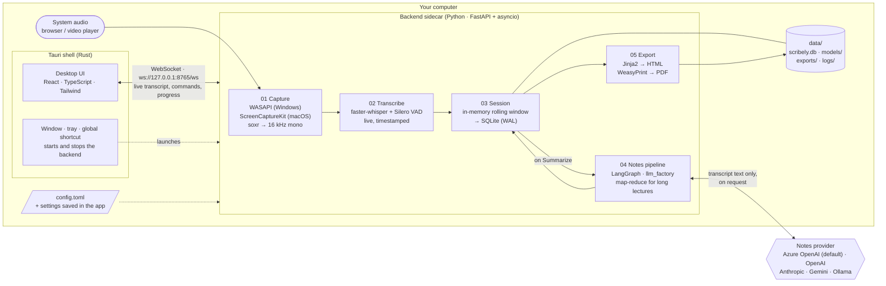

# Scribely

Listen, learn, and let Scribely take the notes: live, on-device transcription plus LLM-structured study notes.

Scribely is a local-first desktop app for **macOS and Windows**. Play a lecture in any browser or video player; Scribely listens to your computer's audio, writes the transcript as it plays, and when you're done turns it into clean study notes you can restructure, edit and export.

## Get started

Step-by-step guides, from cloning the repo to exporting your first notes:

- **[Setup on macOS](SetupMacOS.md)**
- **[Setup on Windows](SetupWindows.md)**

## Features

- **Live transcription** of system audio with [faster-whisper](https://github.com/SYSTRAN/faster-whisper), on your computer. Pick the spoken language and the speech model (tiny to large-v3); models download once, with progress.
- **Recording controls**: record, pause/resume (paused time is left out of the timestamps), live audio-level meter, a global shortcut (**⌘⇧⌥R** / **Ctrl+Shift+Alt+R**), and a tray / menu-bar icon.
- **Notes on request**: ✦ Summarize a stopped session with the model you choose: Azure OpenAI (default, `gpt-4o`), OpenAI, Anthropic, Gemini, or Ollama fully offline. Long lectures are split and summarized in parallel so they never overflow the model's context.
- **Restructure and edit**: rewrite notes as a study outline, Q&A, or a condensed version; fix anything by hand.
- **Search** across session titles, notes and transcripts; jump straight to the matching line.
- **Export** to PDF (styled like the app) or a standalone web page, with the full transcript.
- **First-run setup** for language, speech model, the macOS audio permission and the notes model.

## Privacy

- Audio, transcripts, notes and settings stay on your computer. No account, no cloud storage, no telemetry.
- The only data that leaves your machine is the finished transcript text, sent to the notes provider you configured, and only when you press Summarize or Restructure. With Ollama nothing leaves at all.
- API keys are never saved: you enter yours in Settings each time Scribely starts (or set the provider's environment variable).
- Logs (`data/logs/scribely.log`) stay local and never contain keys or transcript text.

## Architecture



**How a session flows**

1. **Capture**: the backend records the computer's output audio (not the microphone) and resamples it to 16 kHz mono. Pausing drops audio and skips the paused time in the timeline.
2. **Transcribe**: voice activity detection cuts the stream at pauses; faster-whisper turns each piece into timestamped text, with quick live previews in between.
3. **Session**: the UI is fed from an in-memory window; segments are written to SQLite (WAL) about once a second, so a crash loses at most a second.
4. **Notes**: only when you press Summarize on a stopped session. `llm_factory` builds the configured LangChain chat model; short transcripts take one call, long ones are chunked to fit the model's context, summarized in parallel and merged. All output is validated with Pydantic.
5. **Export**: Jinja2 renders the notes and transcript to a web page, or WeasyPrint renders a PDF with the app's fonts and layout.

The Rust shell launches the backend when the app opens and stops it on quit; the backend also exits on its own if the app disappears. Everything crossing the WebSocket is defined once as Pydantic models (`backend/scribely/models.py`) and the TypeScript types are generated from them.

## Tech stack

| Layer | Technology |
| --- | --- |
| Desktop shell | Tauri 2 (Rust): window, tray, global shortcut, backend launch |
| UI | React 19, TypeScript (strict), Tailwind 4, Framer Motion |
| UI ↔ backend | One WebSocket to a local FastAPI sidecar |
| Audio capture | PyAudioWPatch (WASAPI loopback, Windows) · ScreenCaptureKit via PyObjC (macOS) · soxr |
| Speech to text | faster-whisper (CTranslate2) + Silero VAD |
| Storage | SQLite (WAL) + files in `data/` |
| Notes | LangGraph + LangChain providers (OpenAI/Azure, Anthropic, Gemini, Ollama), Pydantic structured output |
| Export | Jinja2 (HTML), WeasyPrint (PDF) |
| Config / logs | TOML via pydantic-settings · structlog |
| Python tooling | uv, ruff, mypy, pytest |

## Repository layout

```
apps/desktop/          Tauri + React app
  src/                 UI: components, state, the typed WebSocket client
  src-tauri/           Rust shell: window, tray, shortcut, backend launch
backend/               Python sidecar
  scribely/
    api/               FastAPI app + /ws handler
    capture/           WASAPI, ScreenCaptureKit and WAV-file capture, permission check
    stt/               faster-whisper streaming, VAD, model catalog
    session/           session lifecycle + SQLite store
    pipeline/          LangGraph notes pipeline, llm_factory, prompts
    export/            HTML/PDF templates and renderers
    models.py          WebSocket schemas (source of the TypeScript types)
  tests/
shared/schemas/        generated TypeScript types
config.toml.example    documented settings
```

## Development

```bash
cd backend && uv sync && cd ..   # Python deps in backend/.venv (nothing installed globally)
pnpm install
pnpm dev                         # opens the app; it starts and stops the backend itself
```

Checks:

```bash
cd backend && uv run pytest && uv run ruff check . && uv run ruff format --check . && uv run mypy .
pnpm typecheck                                        # from the repo root
cd apps/desktop/src-tauri && cargo clippy --all-targets -- -D warnings && cargo test
```

CI runs all of these on macOS, Windows and Linux for every pull request. Configuration lives in `config.toml` (copy `config.toml.example`); settings chosen in the app override it. When running from source, all app data stays in `data/` inside the repo. See `CLAUDE.md` for the project's rules and conventions.

## License

[Apache 2.0](LICENSE). The bundled Inter and Newsreader fonts are under the SIL Open Font License (`backend/scribely/export/fonts/`).
